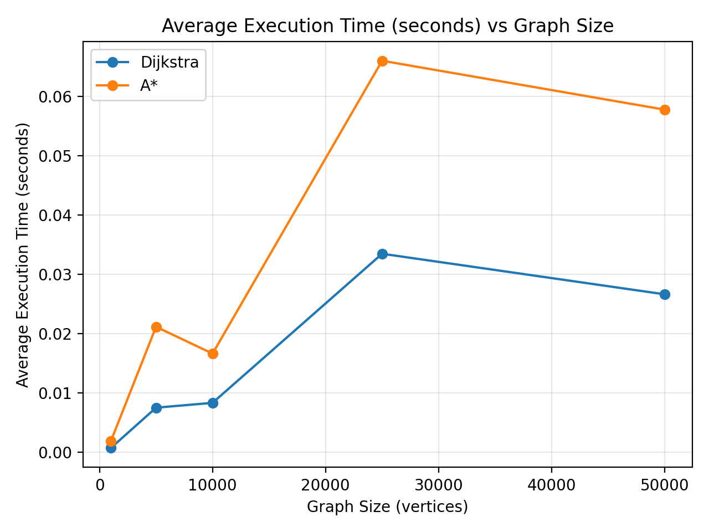
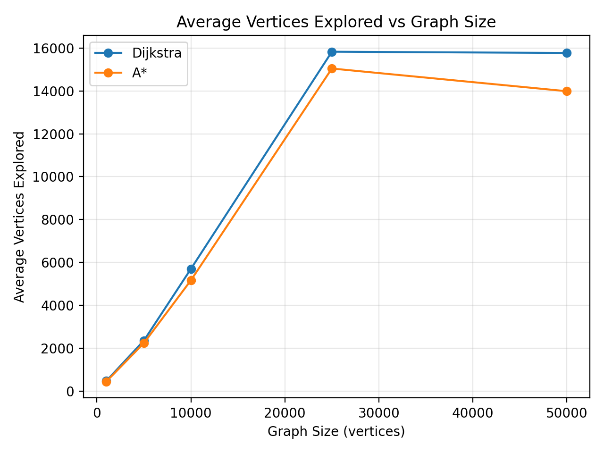
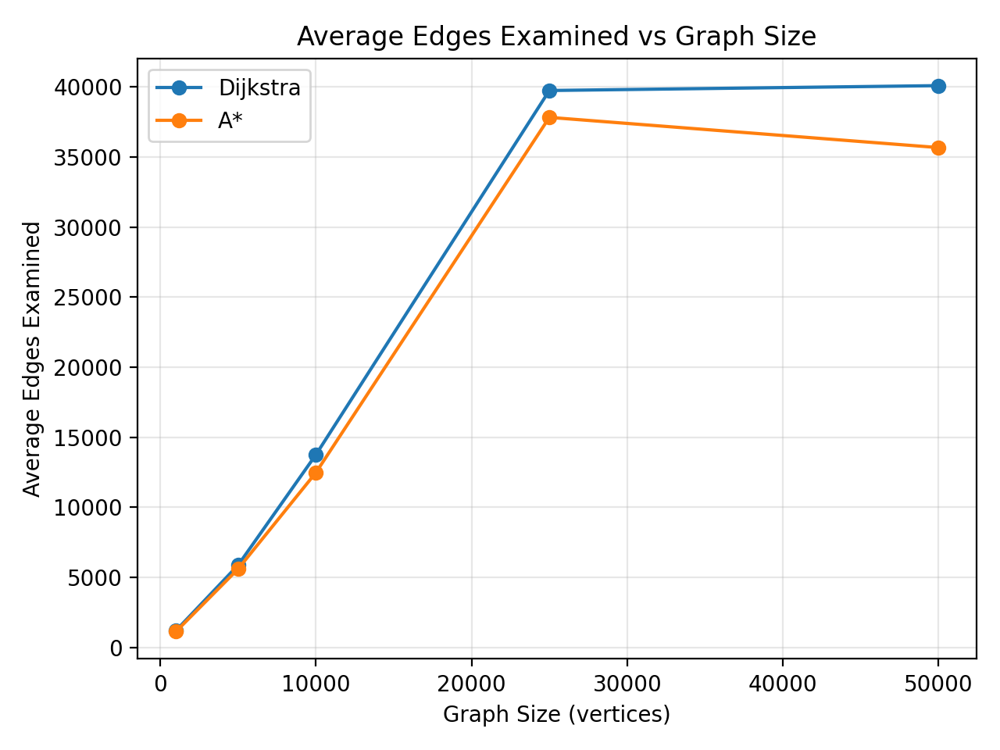

# Shortest-Path Planning in a Large-Scale IoV/UAV Mobility Network

**Course:** Design and Analysis of Algorithms  
**Student:** Richa Yadav  
**Roll No.:** 25MS0112  
**Submission Date:** 15 October 2026

---

## Abstract

This project studies shortest-path planning on a large-scale road mobility network representing a realistic IoV/UAV mobility scenario. The New York road network from the 9th DIMACS Implementation Challenge is converted into a weighted directed graph. Dijkstra's algorithm with a binary min-priority queue and A* search are implemented independently and experimentally compared on multiple graph sizes.

The experiments use graph sizes of 1,000, 5,000, 10,000, 25,000 and 50,000 vertices. For each graph size, five reachable source-destination pairs are evaluated. The experimental results compare shortest-path cost, vertices explored, edges examined and execution time.

---

## Part A – Dataset

### Dataset

**Dataset:** 9th DIMACS Implementation Challenge – New York Road Network (`USA-road-d.NY`)

**Official source:**  
https://www.diag.uniroma1.it/challenge9/download.shtml

The dataset contains a large-scale road network of New York. The `.gr` file provides directed road arcs and distance costs, while the `.co` file provides geographic coordinates for the vertices.

### Full Dataset Statistics

- **Full vertices:** 264,346
- **Full directed edges/arcs:** 733,846

### Dataset Files

- `USA-road-d.NY.gr` — directed graph and distance weights
- `USA-road-d.NY.co` — geographic coordinates

### Graph Mapping

- **Vertex:** A road-network node/intersection.
- **Directed edge:** A feasible directed road movement from one node to another.
- **Weight:** Road distance associated with the directed edge.
- **Graph representation:** Adjacency list.

The dataset is suitable for the experiment because it represents a realistic transportation network with a large number of vertices and directed weighted connections. Geographic coordinates also allow a spatial heuristic to be used for A*.

---

## Part B – Preprocessing and Graph Construction

The DIMACS `.gr` graph file is parsed into an adjacency-list representation. For every vertex, its outgoing neighbors and corresponding edge weights are stored.

The geographic coordinates from the `.co` file are retained separately and are used by the A* heuristic.

The full graph contains 264,346 vertices and 733,846 directed arcs. To perform experiments at different graph sizes, connected subgraphs containing 1,000, 5,000, 10,000, 25,000 and 50,000 vertices were constructed.

### Graph Statistics

| Graph Size | Edges | Average Out-Degree | Maximum Out-Degree |
|---:|---:|---:|---:|
| 1,000 | 2,438 | 2.43800 | 4 |
| 5,000 | 12,126 | 2.42520 | 6 |
| 10,000 | 23,954 | 2.39540 | 6 |
| 25,000 | 62,164 | 2.48656 | 6 |
| 50,000 | 130,522 | 2.61044 | 7 |

Average out-degree is calculated as:

**Average Out-Degree = E / V**

where `E` is the number of directed edges and `V` is the number of vertices.

The average out-degree remains approximately between 2.4 and 2.6 for the tested graph sizes. This indicates that the road-network graphs are relatively sparse.

---

## Part C – Dijkstra's Algorithm

Dijkstra's shortest-path algorithm was implemented independently using a binary min-priority queue with Python's `heapq`.

No built-in shortest-path function was used.

The implementation maintains:

- tentative shortest distances,
- a predecessor structure for path reconstruction,
- a min-priority queue,
- the number of vertices explored,
- the number of edges examined,
- execution time.

The complete shortest path can be reconstructed using the predecessor information.

### Complexity

For an adjacency-list graph with a binary min-heap, the time complexity is:

**O((V + E) log V)**

where `V` is the number of vertices and `E` is the number of edges.

---

## Part D – A* Search

A* search was implemented independently using the evaluation function:

**f(v) = g(v) + h(v)**

where:

- `g(v)` is the cost from the source to vertex `v`,
- `h(v)` is the estimated cost from `v` to the destination,
- `f(v)` is the estimated total path cost through `v`.

### Heuristic

The geographic great-circle distance between the current vertex and the destination is used as the heuristic.

The coordinates from the `.co` file are converted from microdegree representation to geographic coordinates before calculating the distance.

### Admissibility

The road-network edge weights represent physical road distance. The geographic straight-line/geodesic distance between two locations cannot be greater than the actual road distance required to travel between them.

Therefore, the geographic distance provides a lower-bound estimate of the remaining road distance and is an admissible heuristic under the distance-weight interpretation.

The triangle inequality also supports consistency of the heuristic under the same interpretation.

Because the heuristic is admissible, A* can return the same optimal shortest-path cost as Dijkstra.

---

## Part E – Experimental Results

Five reachable source-destination queries were evaluated for each graph size. The reported values are averages over those five queries.

### Experimental Results

| Graph Size | Algorithm | Shortest-Path Cost | Vertices Explored | Edges Examined | Execution Time (s) |
|---:|---|---:|---:|---:|---:|
| 1,000 | Dijkstra | 30,759.4 | 481.6 | 1,206.8 | 0.000690 |
| 1,000 | A* | 30,759.4 | 453.4 | 1,138.8 | 0.001819 |
| 5,000 | Dijkstra | 91,659.2 | 2,364.8 | 5,882.2 | 0.007501 |
| 5,000 | A* | 91,659.2 | 2,245.8 | 5,611.4 | 0.021162 |
| 10,000 | Dijkstra | 170,658.8 | 5,704.4 | 13,760.4 | 0.008320 |
| 10,000 | A* | 170,658.8 | 5,171.0 | 12,485.0 | 0.016634 |
| 25,000 | Dijkstra | 226,865.4 | 15,825.2 | 39,734.0 | 0.033486 |
| 25,000 | A* | 226,865.4 | 15,042.2 | 37,817.2 | 0.066067 |
| 50,000 | Dijkstra | 217,341.2 | 15,767.6 | 40,081.4 | 0.026641 |
| 50,000 | A* | 217,341.2 | 13,984.4 | 35,663.8 | 0.057813 |

### Experimental Observations

1. **Shortest-path cost:** Dijkstra and A* produced the same average shortest-path cost for every tested graph size.
2. **Vertices explored:** A* explored fewer vertices than Dijkstra for all five graph sizes.
3. **Edges examined:** A* also examined fewer edges than Dijkstra for every tested graph size.
4. **Execution time:** Despite exploring fewer vertices and edges, A* took more execution time in these experiments.
5. **Reason for A* timing:** The additional geographic heuristic calculation introduces computational overhead.
6. **Graph size:** The number of edges and search effort generally increase with graph size, although measured execution time is not strictly monotonic because it is affected by the selected queries, graph structure and runtime conditions.

### Plot 1 – Execution Time

### Plot 2 – Vertices Explored

### Plot 3 – Edges Examined

---

## Part F – Analysis

### 1. Why is the selected dataset suitable?

The New York road network is suitable because it is a real large-scale transportation network containing vertices, directed road connections, distance weights and geographic coordinates. These properties naturally map to a weighted graph used for mobility routing.

### 2. How was the road network transformed into a graph?

The `.gr` file was parsed into an adjacency list. Each road-network node became a graph vertex, while every directed arc became a directed weighted edge. The edge weight represents road distance. Coordinates from the `.co` file were stored separately for the A* heuristic.

### 3. Why do Dijkstra and A* return the same shortest-path cost?

Both algorithms solve the shortest-path problem optimally under the given non-negative edge weights. A* uses an admissible geographic heuristic, so it does not overestimate the remaining cost. Therefore, for the same source-destination pair, A* and Dijkstra return the same optimal path cost.

The experimental results confirm this: both algorithms produced identical average shortest-path costs for all five tested graph sizes.

### 4. Which algorithm explores fewer vertices?

A* explored fewer vertices in every tested graph size.

For example:

- At 1,000 vertices, Dijkstra explored 481.6 vertices on average, while A* explored 453.4.
- At 50,000 vertices, Dijkstra explored 15,767.6 vertices, while A* explored 13,984.4.

Thus, the geographic heuristic successfully reduced the search space.

### 5. How does graph size affect execution time?

Larger graphs generally contain more vertices and edges, increasing the amount of work required by shortest-path algorithms. However, the measured execution times in this experiment are not strictly increasing with graph size.

For example, the 50,000-vertex Dijkstra experiment took 0.026641 seconds, which was lower than the 25,000-vertex result of 0.033486 seconds. This can occur because the measured time depends not only on graph size but also on the selected source-destination queries, graph structure and runtime conditions.

Therefore, execution time should be interpreted together with the number of vertices explored and edges examined.

### 6. How does graph density affect search?

The average out-degree indicates how many outgoing edges are associated with each vertex on average. Higher average degree means that more outgoing edges may need to be considered during search.

In the experiments, the average out-degree ranged from 2.3954 to 2.61044. As the number of outgoing connections increases, the number of edge relaxations and examined edges can also increase.

### 7. What is the complexity of Dijkstra's algorithm?

With an adjacency list and a binary min-priority queue, Dijkstra's algorithm has time complexity:

**O((V + E) log V)**

The adjacency-list representation is particularly appropriate for this road network because the graph is relatively sparse.

### 8. Is the A* heuristic admissible and consistent?

The geographic straight-line/geodesic distance is admissible when the graph edge weights represent physical road distance in compatible units. A physical route along roads cannot be shorter than the corresponding geographic lower bound.

The triangle inequality provides the basis for consistency under the same distance interpretation.

The experimental results also support the correctness of the heuristic because A* returned the same shortest-path cost as Dijkstra for all tested graph sizes.

### 9. What were the main preprocessing difficulties?

The main challenges were:

- parsing a large DIMACS graph,
- handling the large number of vertices and directed arcs,
- maintaining an adjacency-list representation,
- preserving geographic coordinates,
- constructing experimental graph sizes,
- selecting reachable source-destination pairs,
- managing memory during preprocessing and experimentation.

### 10. Which algorithm is recommended?

The experimental results show that A* reduced the number of vertices explored and edges examined for every tested graph size. However, in this implementation A* required more execution time because of the additional heuristic calculations.

Therefore, the choice depends on the objective:

- **A*** is attractive when reducing the search space is important and reliable geographic coordinates are available.
- **Dijkstra** is a strong baseline and may be faster in this implementation when heuristic-computation overhead dominates.

For a large spatial mobility network, A* remains particularly useful when the heuristic can be computed efficiently and the reduction in search effort is important.

---

## Bonus – Dynamic Edge Cost

A dynamic mobility-aware edge cost can be modelled as:

**w(u,v) = α × d(u,v) + β × c(u,v)**

where:

- `d(u,v)` represents physical distance,
- `c(u,v)` represents congestion or another dynamic mobility factor,
- `α` and `β` control the relative importance of distance and congestion.

If congestion changes over time, edge weights can also change. Consequently, the optimal route may change dynamically.

---

## Conclusion

This project implemented and experimentally compared Dijkstra's algorithm and A* search on the New York road network from the 9th DIMACS Implementation Challenge.

The complete dataset contains 264,346 vertices and 733,846 directed arcs. Experiments were conducted on graph sizes ranging from 1,000 to 50,000 vertices.

Both algorithms produced the same shortest-path costs for the tested queries, confirming the optimality of the A* implementation with the selected admissible geographic heuristic.

A* consistently explored fewer vertices and examined fewer edges than Dijkstra. However, its execution time was higher in these experiments because calculating the geographic heuristic introduced additional overhead.

Overall, the experiment demonstrates the trade-off between reducing search effort and the computational cost of heuristic evaluation in large-scale spatial mobility networks.

---

## Reproducibility

The project contains the source code required to reproduce the experiments.

Main files:

- `run_experiments.py` — runs the shortest-path experiments.
- `plot_results.py` — generates the experimental plots.
- `src/io_utils.py` — parses the DIMACS dataset.
- `src/graph_utils.py` — constructs graph subsets and calculates graph statistics.
- `src/algorithms.py` — contains the Dijkstra and A* implementations.
- `README.md` — provides project setup and execution instructions.

The experimental results reported above were generated by running the provided implementation on the New York DIMACS road-network dataset.

**Dataset source:** 9th DIMACS Implementation Challenge  
https://www.diag.uniroma1.it/challenge9/download.shtml